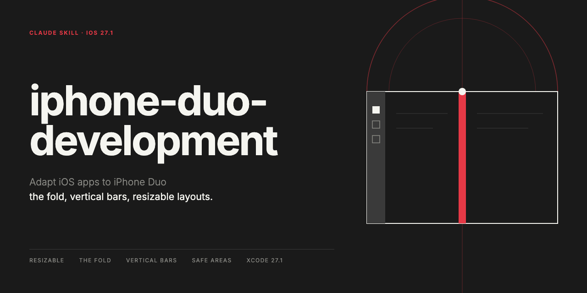

# iphone-duo-development



**English** | [日本語](#日本語)

A Claude skill for adapting iOS apps to **iPhone Duo** — Apple's foldable iPhone, announced 2026-09-09 and shipping 2026-10-23 with iOS 27.1.

The premise of this skill is that iPhone Duo is not a new platform. It is an iPhone whose window size changes a great deal. Most of the work is making layouts resizable, which is the same work as supporting iPad. The Duo-specific parts — the fold, vertical bars, asymmetric safe areas — sit on top of that.

## What you can ask it

The skill turns a vague "make this work on Duo" into a specific, ordered list of changes. Typical asks:

- **"Get this app ready for iPhone Duo."** Claude works the adaptation checklist against your code: screen-based layout math, idiom and orientation branching, fixed widths, toolbar items with no symbol, bars that are not attached to a navigation container, safe-area math that assumes the left and right insets match. The list is ordered by how much breakage each item causes, so the first few fixes do most of the work.
- **"Why does my layout break on the inner display?"** The failure modes are a short, known list, so the answer is a diagnosis rather than a guess. The asymmetric safe areas — the one failure that resizing a window never surfaces — get checked explicitly.
- **"My toolbar buttons vanished on the outer display."** When the system moves bars to the side, an item with a title but no icon is dropped, and a hand-rolled toolbar does not participate at all. Claude finds which of yours are affected and what each one needs.
- **"Keep the controls off the fold."** The fold APIs come in layers, and the common mistake is reaching too low. Claude picks the highest layer that solves the problem — a system container, an `ArrangementView`, or `ReservedRegion` — instead of computing a layout from the hinge angle.
- **"Can I even build and test this right now?"** A toolchain and simulator reality check: whether your Xcode produces a Duo-capable binary, whether any installed runtime supports `iPhone19,4`, what the Duo runtime cannot run (most app extensions, StandBy), and how to get useful verification without it.
- **"Walk every screen across the poses."** On the simulator, [`duoctl`](https://github.com/skarol/duoctl) opens, closes, half-folds and rotates the device and captures each pose — so the fold bugs that are invisible on a flat screen actually get seen.
- **"Plan the release around the launch."** The sequence — toolchain, App Review, release — and where App Store featuring nominations have to sit in front of it.

It is a knowledge skill, not a tool. It does not refactor your project unattended and it does not replace the simulator. What it does is keep the work in the order that matters, with the Duo-specific traps known up front instead of discovered one screen at a time.

## Relation to Xcode's own App Resizability skill

Xcode 27.1 ships Apple's coding-assistant skill for this task, `app-resizability`, as a prompt template inside `IDEIntelligenceChat.framework`; the path is in `references/environment.md`. It is worth reading, and it overlaps here on resizable layouts and the deprecated shared-state APIs (`mainScreen`, `interfaceOrientation`, `userInterfaceIdiom`). This skill covers what that one does not: the vertical bar rules, the fold APIs, the toolchain and simulator reality, pose verification, and release timing — with Tech Talk timecodes attached so a claim can be checked.

## What it covers

- **Resizable layouts** — size classes per display and orientation, sizing against the container, and what to remove (`UIScreen.main`, idiom checks, orientation checks, fixed widths)
- **Asymmetric safe areas** — a failure mode that resizing the window does not surface, and the one portrait-locked apps are most exposed to
- **Vertical bars** — when toolbars and tab bars move to the side, why title-only items do not appear there, ordering, overflow priority, and the exceptions for sheets, split views and inspectors
- **The fold** — reserved regions (`division` and `occlusion`), arrangement views, and the principle that matters most: keep interactive elements off the fold
- **Build and verification environment** — the Xcode 27.1 requirement, why older toolchains refuse to create a Duo simulator, and which runtimes actually support the device
- **Release timing** — the review sequence and App Store featuring nominations

## Layout

```
SKILL.md                          Core guidance, adoption checklist, common failures
references/bars.md                Vertical bars and toolbar APIs in detail
references/reserved-regions.md    The fold, reserved regions, arrangement views, multiple windows
references/environment.md         Toolchain, simulators, CI, release timing
```

For ordinary use `SKILL.md` alone is enough. The reference files are loaded when the work moves into their area.

## Installation

Copy it into Claude's skills directory.

```bash
cp -R iphone-duo-skill ~/.claude/skills/iphone-duo-development
```

To use it in a single project:

```bash
cp -R iphone-duo-skill <project>/.claude/skills/iphone-duo-development
```

It triggers on mentions of iPhone Duo, foldable devices, the inner or outer display, the fold, the hinge, `ArrangementView`, `ReservedRegion`, and vertical bars. It also triggers on work like making an existing iPhone app resizable or adopting size classes, even when Duo is not named.

## Sources

Built from Apple's primary material.

- Tech Talks 111461–111466 (cited with timecodes). Each session page has its transcript and official code samples embedded in the HTML; the commands for extracting them are in `references/environment.md`
- Human Interface Guidelines — *Designing for iPhone Duo*
- *Preparing your app for iPhone Duo* (Technology Overviews)
- SwiftUI / UIKit reference for the relevant iOS 27 APIs

API availability was read out of the iOS 27.1 SDK's `.swiftinterface` files rather than the documentation, which lags, and re-checked against the released SDK (Xcode 27.1, 27A9275) on 2026-10-19. The environment behavior in `references/environment.md` — the simulator's `Incompatible device` error, the device type and runtime profiles behind it, and how to tell which runtimes support Duo — was verified against an installed toolchain, not copied out of documentation.

Transcript text is Apple's copyrighted work and is not included in this repository.

## License

MIT

---

# 日本語

[English](#iphone-duo-development) | **日本語**

iOS アプリを **iPhone Duo**（Apple の折りたたみ iPhone。2026-09-09 発表、2026-10-23 に iOS 27.1 とともに発売）へ対応させるための Claude スキルです。

このスキルの前提は、iPhone Duo は新しいプラットフォームではない、という点にあります。ウインドウのサイズが大きく変わる iPhone です。作業のほとんどはレイアウトをリサイズ可能にすることで、これは iPad 対応と同じ内容です。折り目・垂直バー・非対称なセーフエリアといった Duo 固有の部分は、その上に乗ります。

## 何ができるか

「Duo に対応させて」という曖昧な依頼を、具体的で順序のついた変更の一覧に変えます。たとえば次のような頼み方になります。

- **「このアプリを iPhone Duo に対応させて」** — 対応チェックリストをコードに当てます。画面サイズを基準にしたレイアウト計算、idiom や向きでの分岐、固定幅、シンボルの無いツールバー項目、ナビゲーションコンテナに載っていないバー、左右のインセットが同じだと仮定したセーフエリア計算。一覧は壊れ方の大きい順に並んでいるので、最初の数件で大半が片付きます。
- **「内側ディスプレイでレイアウトが崩れるのはなぜ？」** — 崩れ方の型は短い既知の一覧なので、推測ではなく診断が返ります。ウインドウのリサイズでは絶対に表に出ない非対称なセーフエリアも、明示的に確かめます。
- **「外側ディスプレイでツールバーのボタンが消えた」** — システムがバーを側面へ移すとき、タイトルだけでアイコンの無い項目は落ち、自前で組んだツールバーはそもそも参加しません。どの項目が該当し、それぞれ何が必要かを特定します。
- **「操作要素を折り目から外して」** — 折り目の API は層になっていて、ありがちな失敗は低い層に手を伸ばすことです。ヒンジの角度から自分でレイアウトを計算するのではなく、解決できる一番高い層——システムのコンテナ、`ArrangementView`、`ReservedRegion`——を選びます。
- **「そもそも今ビルドして試せる？」** — ツールチェーンとシミュレータの現実確認です。手元の Xcode が Duo 対応のバイナリを作れるか、`iPhone19,4` に対応したランタイムが入っているか、Duo のランタイムで動かないもの（ほとんどのアプリ拡張、StandBy）は何か、それが無いときに何なら確かめられるか。
- **「全画面を姿勢ごとに見て回って」** — シミュレータでは [`duoctl`](https://github.com/skarol/duoctl) が開く・閉じる・半開き・回転を動かして各姿勢を撮ります。平らな画面では見えない折り目の不具合が、実際に目に入るようになります。
- **「発売に合わせてリリースの段取りを立てて」** — ツールチェーン → 審査 → リリースの順序と、その手前に置かなければならない App Store フィーチャー申請の位置。

これは知識のスキルで、道具ではありません。勝手にプロジェクトを書き換えることはなく、シミュレータの代わりにもなりません。やることは、作業を効く順番に保ち、Duo 固有の落とし穴を、一画面ずつ踏んで気づくのではなく最初から分かった状態にしておくことです。

## Xcode 自身の App Resizability スキルとの関係

Xcode 27.1 には、この用途に向けた Apple 自身のコーディングアシスタント用スキル `app-resizability` が、`IDEIntelligenceChat.framework` 内のプロンプトテンプレートとして入っています（パスは `references/environment.md`）。一度読む価値があり、リサイズ対応レイアウトと非推奨の共有状態 API（`mainScreen`、`interfaceOrientation`、`userInterfaceIdiom`）については内容が重なります。このスキルは、そちらが扱っていない部分——垂直バーの規則、折り目の API、ツールチェーンとシミュレータの実情、姿勢ごとの検証、リリースの時期——を担当し、主張を確かめられるよう Tech Talk のタイムコードを付けています。

## 扱う範囲

- **リサイズ対応レイアウト** — ディスプレイと向きごとの size class、コンテナ基準のサイズ指定、取り除くもの（`UIScreen.main`、idiom 判定、向き判定、固定幅）
- **非対称なセーフエリア** — ウインドウのリサイズでは表に出ない失敗の型であり、縦向き固定のアプリが最もさらされている箇所
- **垂直バー** — ツールバーとタブバーが側面へ移る条件、タイトルだけの項目がそこに出ない理由、配置順、オーバーフローの優先度、シート・分割ビュー・インスペクタの例外
- **折り目** — 予約領域（`division` と `occlusion`）、arrangement view、そして最も重要な原則である「操作要素を折り目に置かない」
- **ビルドと検証環境** — Xcode 27.1 要件、古いツールチェーンで Duo シミュレータの作成が拒否される理由、どのランタイムが実際に端末へ対応しているか
- **リリースの時期** — 審査の段取りと App Store フィーチャー申請

## 構成

```
SKILL.md                          中核の指針、対応チェックリスト、ありがちな失敗
references/bars.md                垂直バーとツールバー API の詳細
references/reserved-regions.md    折り目、予約領域、arrangement view、複数ウインドウ
references/environment.md         ツールチェーン、シミュレータ、CI、リリース時期
```

通常の用途では `SKILL.md` だけで完結します。参照ファイルは、作業がその領域に入ったときに読み込まれます。

## 導入

Claude のスキルディレクトリへコピーします。

```bash
cp -R iphone-duo-skill ~/.claude/skills/iphone-duo-development
```

プロジェクト単位で使う場合は次のようにします。

```bash
cp -R iphone-duo-skill <project>/.claude/skills/iphone-duo-development
```

iPhone Duo、折りたたみ端末、内側・外側ディスプレイ、折り目、ヒンジ、`ArrangementView`、`ReservedRegion`、垂直バーへの言及で起動します。加えて、Duo と明示されていなくても、既存の iPhone アプリをリサイズ対応にする、size class を導入するといった作業でも起動します。

## 出典

Apple の一次資料から構成しています。

- Tech Talks 111461〜111466（タイムコード付きで引用）。各セッションのページには、トランスクリプトと公式コードサンプルが HTML に埋め込まれています。抽出用のコマンドは `references/environment.md` に記載しています
- Human Interface Guidelines — *Designing for iPhone Duo*
- *Preparing your app for iPhone Duo*（Technology Overviews）
- 関係する iOS 27 の API についての SwiftUI / UIKit リファレンス

API の availability は、記述が遅れるドキュメントではなく iOS 27.1 SDK の `.swiftinterface` から読み取り、リリース版 SDK（Xcode 27.1、27A9275）に対して 2026-10-19 に再確認しています。`references/environment.md` に書かれた環境の挙動——シミュレータの `Incompatible device` エラー、その原因であるデバイスタイプとランタイムのプロファイル、どのランタイムが Duo に対応しているかの判別——も、ドキュメントからの引き写しではなく、導入済みのツールチェーンに対して検証した結果です。

トランスクリプト本文は Apple の著作物であるため、このリポジトリには含めていません。

## ライセンス

MIT
